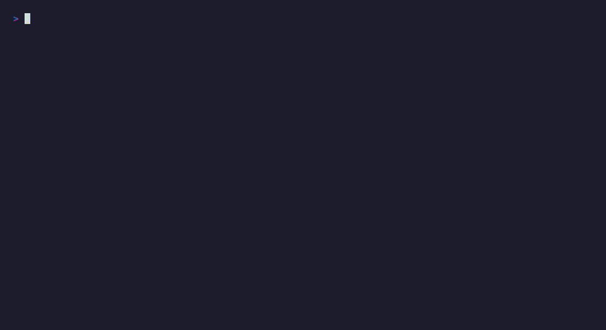
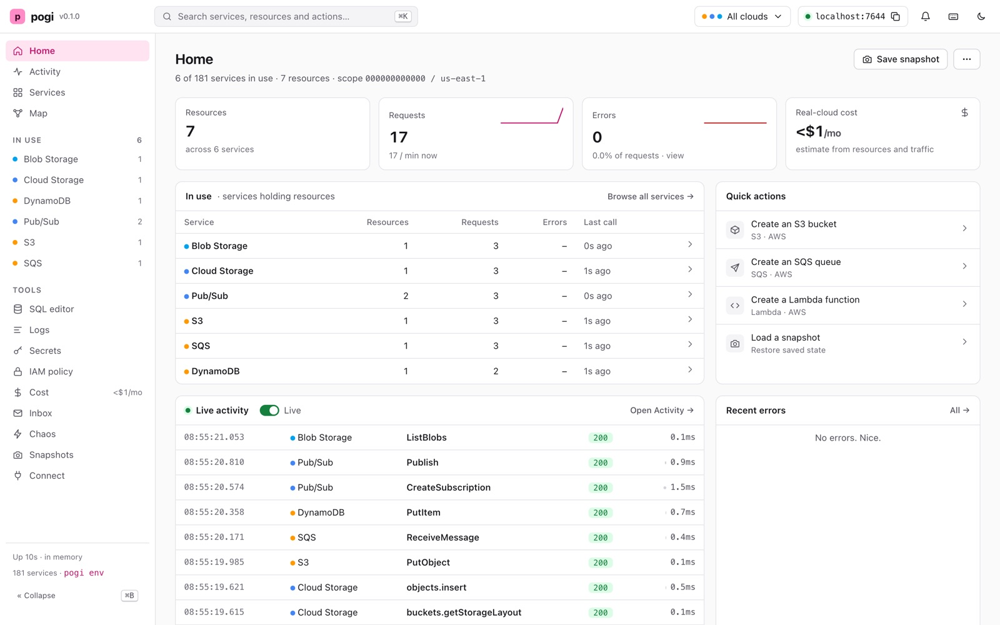

<p align="center">
  <picture>
    <source media="(prefers-color-scheme: dark)" srcset="docs/images/wordmark-dark.svg">
    
  </picture>
</p>

<p align="center">
  <b>The whole cloud on your machine.</b><br>
  AWS, Google Cloud and Azure in one small program, on one port. Free, offline, no account.
</p>

<p align="center">
  <a href="docs/README.md">Docs</a> ·
  <a href="#install">Install</a> ·
  <a href="CHANGELOG.md">Changelog</a> ·
  <a href="https://pogi.nrnx.dev">Website</a>
</p>

<p align="center">
  <a href="https://github.com/nrndev/pogi/actions/workflows/preflight.yml"></a>
  <a href="https://github.com/nrndev/pogi/releases/latest"></a>
  <a href="LICENSE"></a>
  <a href="https://pkg.go.dev/github.com/nrndev/pogi"></a>
  <a href="https://scorecard.dev/viewer/?uri=github.com/nrndev/pogi"></a>
</p>

<p align="center">
  
</p>

pogi runs AWS, Google Cloud and Azure on your laptop. Point your SDKs, the cloud CLIs, Terraform or the CDK at it, and they work the way they do against the real cloud: no account, no bill, and nothing leaves your machine. It is one program on one port, it starts in about 25 ms, and it covers 181 services.

> [!NOTE]
> pogi is new, at version 0.x. Flags, config keys and APIs may still change between releases, and the [changelog](CHANGELOG.md) lists every change.

## Quick start

**1. Install pogi.** On macOS, with Homebrew. For Linux, Windows, Docker and Go, see [Install](#install).

```sh
brew install nrndev/tap/pogi
```

**2. Start it.** This opens a live terminal screen. Add `--headless` if you only want plain logs.

```sh
pogi
```

**3. Point your tools at it.** In a second terminal, this sets the endpoint and test credentials for the AWS, Google Cloud and Azure tools.

```sh
eval "$(pogi env)"
```

**4. Make something.** Use the CLIs you already have.

```sh
aws s3 mb s3://demo
gcloud storage buckets create gs://demo
az storage container create -n demo
```

**5. Look inside.** Open the web console at <http://localhost:7644/_pogi/> to see your buckets and every call you made.

That's all your code needs too: only the endpoint and the credentials change, and `pogi env` sets both.

## Why pogi

**One place for three clouds.** AWS, Google Cloud and Azure all answer on `localhost:7644`: 131 AWS services, 26 Google Cloud and 24 Azure. You don't need a separate emulator for each service.

**It behaves like the real thing.** pogi is tested with the official SDKs. Lambda runs Python and Node.js directly, Terraform and `cdk deploy` work, and services trigger each other as they do in the cloud: S3 to SQS, SNS to Lambda, Pub/Sub push, Event Grid and more.

**It's made for tests.** Reset everything in one command, save and load snapshots, make chosen calls fail or slow down, and keep state on disk or in memory. Run it in CI, or start it right inside your Go tests.

**It's a drop-in for LocalStack.** It has the same health endpoint, init hooks and `Ready.` log line, and `--port 4566` keeps your old endpoint. See [Migrate from LocalStack](docs/how-to/migrate-from-localstack.md).

**It stays on your machine.** pogi listens on 127.0.0.1 only, refuses requests from other websites, and never phones home.

## The console

<picture>
  <source media="(prefers-color-scheme: dark)" srcset="docs/images/console-dark.jpg">
  
</picture>

While pogi runs, the console at `http://localhost:7644/_pogi/` shows what your code did:

- every call, and the chain of calls one request set off across services;
- a map of your resources and how they connect, with live traffic;
- a least-privilege IAM policy built from what each caller really did, which you can enforce with `--iam soft` or `--iam strict`;
- a rough monthly estimate of what your setup would cost in the real clouds;
- chaos rules and snapshots;
- a SQL editor, your secrets, and an inbox for the email, SMS and push messages your apps sent.

## Use it from your coding agent

pogi has a built-in MCP server, so AI coding agents such as Claude Code, Cursor and Codex can look inside your local cloud and drive it while they work. Your agent can deploy a stack, invoke the function it just wrote, read the function's logs, peek at a queue, and check which IAM calls were denied, all without touching a real account.

Add it to Claude Code with one line (pogi must be running):

```sh
claude mcp add pogi -- pogi mcp
```

`pogi mcp --print-config` prints the setup for Cursor and Codex too, and `pogi agents init` adds a short brief on using pogi to your project's AGENTS.md.

The server has 22 tools. Agents use them to:

- see what's there: resources, their details, the request log, and any request in full;
- debug: IAM decisions, messages waiting in a queue, the email and SMS your app sent, function logs;
- act: invoke a function, deploy or delete a CloudFormation stack, seed resources, and reset;
- test failure: save and load snapshots, and add or clear chaos rules.

Cloud calls themselves still go through the normal SDKs and CLIs, so the agent tests your code the same way you would. The [CLI reference](docs/reference/cli.md#pogi-mcp-run-the-mcp-server-for-ai-agents) lists every tool.

## Install

**macOS** with Homebrew:

```sh
brew install nrndev/tap/pogi
```

**Linux** (Debian, Ubuntu) with the `.deb` package. On Arm, use `arm64` in place of `amd64`:

```sh
curl -LO https://github.com/nrndev/pogi/releases/download/v0.1.0/pogi_0.1.0_linux_amd64.deb
sudo apt install ./pogi_0.1.0_linux_amd64.deb
```

Fedora, RHEL and Amazon Linux use the `.rpm` from the same place: `sudo dnf install ./pogi_0.1.0_linux_amd64.rpm`.

**Windows** with Scoop:

```powershell
scoop bucket add nrndev https://github.com/nrndev/scoop-bucket
scoop install nrndev/pogi
```

**Docker**, with nothing to install. The image includes Python and Node.js, so functions run inside it. Ports 10000 to 10002 are for Azure Storage.

```sh
docker run --rm -p 127.0.0.1:7644:7644 -p 127.0.0.1:10000-10002:10000-10002 ghcr.io/nrndev/pogi
```

**Go**, version 1.27.2 or newer:

```sh
go install github.com/nrndev/pogi/cmd/pogi@latest
```

You can also download a binary for Linux, macOS or Windows, on Intel or Arm, from the [releases page](https://github.com/nrndev/pogi/releases). After installing, `pogi doctor` checks your setup. [Install pogi](docs/how-to/install.md) has more detail.

## Use it with

| Tool | How |
|---|---|
| AWS CLI and SDKs | `eval "$(pogi env)"`, or `pogi aws …`. [Connect your tools](docs/how-to/connect-your-tools.md#sdks-and-clis) |
| Terraform | `pogi tf > pogi_override.tf`. [Terraform](docs/how-to/connect-your-tools.md#terraform) |
| AWS CDK | `cdk bootstrap` and `cdk deploy`, no wrapper. [CDK](docs/how-to/connect-your-tools.md#cdk) |
| Google Cloud | Client libraries and `gcloud` read the variables `pogi env` sets. [Google Cloud](docs/how-to/connect-your-tools.md#google-cloud) |
| Azure | Azurite ports for storage, HTTPS for Cosmos DB and Key Vault. [Azure](docs/how-to/connect-your-tools.md#azure) |
| Go tests | Start pogi in-process from your tests. [Go tests](docs/how-to/connect-your-tools.md#go-tests) |
| Coding agents | `pogi mcp`, and `pogi agents init` for AGENTS.md. [Use it from your coding agent](#use-it-from-your-coding-agent) |

## Services

<details>
<summary><b>181 services</b>: 131 AWS, 26 Google Cloud and 24 Azure. Click to see them all.</summary>

<!-- services:start (generated from the registry and docs/reference/coverage.yaml by `go generate .`) -->
| Cloud | Services |
|---|---|
| **AWS** | S3, SQS, SNS, DynamoDB + Streams, Lambda, API Gateway v1 + v2, Step Functions, EventBridge + Scheduler, Kinesis / Firehose, CloudFormation, IAM, STS, KMS, Secrets Manager, CloudWatch Logs, CloudWatch Metrics, SES v1 + v2, Cognito user pools, AppSync, EventBridge Pipes, API Gateway WebSockets, Cognito identity pools, IoT Core, Cloud Map, CloudTrail, Fault Injection Service, CodeDeploy + CodePipeline, Organizations + SCPs, Verified Permissions, Resource Explorer, AppConfig, CloudFront, S3 Vectors, SES SMTP, IAM Identity Center, Security services, Transfer Family, DataSync, S3 Tables, AWS Backup, Config, Managed Prometheus, RUM, OAM, Cloud Control API, Beanstalk, EMR, MWAA, Flink, Lightsail, DMS, Lake Formation, Connect, Bedrock and the AI services, Cost services, ACM, Route 53, EC2 network, Tagging, and 16 more long-tail services generated from the AWS API models (see [docs/reference/aws-long-tail.md](docs/reference/aws-long-tail.md)); with Docker running: Systems Manager (SSM), RDS / ElastiCache, ECR, ECS, ELB v2, EC2 transit gateways, flow logs, hosts and images, EKS, EC2 instances, Auto Scaling + Application Auto Scaling, Batch, CodeBuild, RDS extras, ElastiCache users / MemoryDB, MSK, Amazon MQ, OpenSearch Service, Glue + Athena, Redshift + Data API + Serverless, Timestream for InfluxDB |
| **Google Cloud** | Cloud Storage, Pub/Sub, Firestore (Native), Firestore (Datastore mode), Secret Manager, Cloud Logging, Cloud Monitoring, Cloud Tasks, Cloud Scheduler, Eventarc, IAM, IAM Credentials, OAuth2, STS, Resource Manager, Service Usage, Cloud KMS, Firebase Auth, Long-running operations; with Docker running: Cloud SQL, Cloud Run, BigQuery, Cloud Functions, Managed Kafka, Kubernetes Engine, Compute Engine, Artifact Registry |
| **Azure** | Blob Storage, Queue Storage, Table Storage, Cosmos DB (NoSQL), Key Vault, Service Bus, Event Hubs, Event Grid, App Configuration, SignalR, Communication Services email, Resource Manager, Entra ID, Managed Identity, Graph, Management planes (ARM), Azure Monitor, Virtual Network, API Management; with Docker running: Azure Functions, Azure SQL, PostgreSQL, MySQL, MariaDB, Cache for Redis, Kubernetes Service, Container Registry, Container Instances, Container Apps, Virtual Machines |
<!-- services:end -->

</details>

Most services run inside pogi itself. The ones marked "with Docker running" start real software, such as Postgres, Redis or Kafka, in Docker, Podman, Colima or OrbStack.

## What pogi doesn't do

pogi is not the real cloud. Some services go deep, with real behavior wired to other services; others cover the common create, read and delete calls. The [coverage page](docs/reference/coverage.md) says what each one does and what it doesn't do yet.

It's built for tests and local development. It keeps data in memory by default and limits uploads to 10 MB (raise that with `--max-upload-mb`), so don't run it as a server for other people.

It never calls the real clouds, so never give it real credentials. `pogi env` sets test ones for you.

## Learn more

- **Docs:** [tutorials, how-to guides, reference and explanation](docs/README.md). New here? Start with the [first run tutorial](docs/tutorials/first-run.md), or read the [FAQ](docs/explanation/faq.md).
- **Contributing:** bug reports, ideas and pull requests are welcome. [CONTRIBUTING.md](CONTRIBUTING.md) covers building, testing, adding a service and running the security scans.
- **Security:** report vulnerabilities privately, as [SECURITY.md](SECURITY.md) describes.
- **License:** [MIT](LICENSE). Some AWS services are generated from the AWS API models, which are under the Apache 2.0 license ([NOTICE](NOTICE)).
