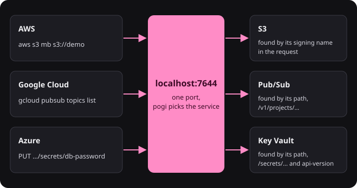

# How pogi works

## One binary

pogi is a single Go program. There is no separate server for each cloud, no database to set up and no container to run the core. At start, pogi builds the services it is asked to run (`--services` picks which) and keeps their state in memory.

- Services that run real software, such as RDS or Cloud SQL, start a container on first use. They need Docker.
- Lambda functions run on your machine in Python or Node.js. Other runtimes use Docker.

Because everything is in one process, services call each other directly. An S3 bucket notification can reach an SQS queue, an SNS topic can invoke a Lambda function, and a Cloud Storage event can reach Pub/Sub, with no network hop outside pogi.

## One port

AWS, Google Cloud, Azure, the web console (at `http://localhost:7644/_pogi/`), the REST API and the MCP server all answer on the main port, 7644. The same port speaks HTTPS (with a certificate from pogi's own certificate authority, or CA) and gRPC, which the Google Cloud client libraries use.

A few services need their own ports, because their clients expect it:

- Azure Storage on Azurite's `10000` to `10002`
- SES SMTP
- IoT MQTT
- AMQP for Service Bus and Event Hubs
- SFTP for Transfer Family
- a Docker registry for ECR

See [Configuration](../reference/configuration.md#ports).

## How does a request find its service?

You send every request to the same address. pogi looks at the request and picks the service. It tries these in order and stops at the first that fits:

| Step | What pogi checks |
|---|---|
| 1. pogi's own paths | `/_pogi/...`, `/_localstack/...`, `/_aws/...` and a few more are pogi's own endpoints, not cloud APIs. See the [REST API](../reference/rest-api.md). |
| 2. gRPC | An HTTP/2 request with a gRPC content type is a Google Cloud call. |
| 3. `X-Amz-Target` header | AWS JSON services name themselves in it, such as `DynamoDB_20120810`. Newer AWS services that use CBOR name the service in the path. |
| 4. Each service's own matcher | Services that can be told apart by path, host name or header say so. Cloud Storage lives under `/storage/v1/`. Key Vault is found by paths such as `/secrets/...` with an `api-version` query. Host names matter for S3 virtual-host style (`<bucket>.aws.localhost`), `<api>.execute-api.localhost` and `<url-id>.lambda-url.localhost`. |
| 5. SigV4 signing name | AWS signs each request with SigV4, its signing method, for a service name such as `sns` or `lambda`. pogi reads it from the `Authorization` header, or from a presigned URL. |
| 6. A browser at `/` | A request for the home page that asks for HTML shows the console. |
| 7. S3 | Anything left over, such as unsigned or presigned requests, goes to S3, as on AWS. |

The credentials in the request say who is calling. The default `test` credentials are root. An access key that belongs to an IAM user maps to that user. (IAM is the set of rules for who may call what.) See [IAM: record, then enforce](iam.md).

## What does pogi record?

Every request that reaches a service goes into the request log: the service, the operation, the status, the time it took, and the headers and bodies. The log keeps the last 1000 calls. The console's Activity page (its Requests view), `pogi logs` and `GET /_pogi/api/requests` all read it.

Each request also gets a trace ID, a label that ties the steps of one chain together. A flow is one chain of calls and deliveries that share a trace ID. pogi's own bookkeeping, such as the trace ID, travels beside each message, never inside the attributes or properties of your message. Your code sees the same message it would see on the real cloud. [Flows and the Map](flows-and-the-map.md) explains how trace IDs become flows.

## Where does state live?

In memory by default, so a restart starts clean. You can write it to disk with a storage mode, or save it under a name with a snapshot. Each service keeps its own state, so you can reset one service or all of them. See [Save and load snapshots](../how-to/save-and-load-snapshots.md).

## Why is pogi built this way?

pogi replaces several tools with one program that needs nothing else to run. These choices follow from that, and differ from LocalStack:

| Choice | What it means |
|---|---|
| Three clouds | Google Cloud and Azure run in the same process and port, free. The Google Cloud client libraries read `STORAGE_EMULATOR_HOST`, `PUBSUB_EMULATOR_HOST` and the like. The Azure ones use Azurite's connection string. `pogi env` sets all of them. |
| Every service is always on | There is no lazy per-service start to wait for. Services are built when pogi starts. Heavy parts (Docker containers, models, the MCP tool schemas) start on first use. |
| Docker is optional | Without it, RDS, ECS, EKS, ElastiCache and the like still create and describe, as metadata, and Lambda runs Python and Node.js natively. With it, they run real engines in containers. |
| Depth differs by service | Some behave like the real thing in ways LocalStack's community edition does not (IAM enforcement, a real SFTP server, a real container registry). Others are bookkeeping only. [Coverage](../reference/coverage.md) and [AWS long tail](../reference/aws-long-tail.md) list which. |
| No account, no token | There is no license check, and pogi does not phone home. |
| Bind address | pogi listens on `127.0.0.1` (and `::1`) by default. A `--host` that other machines can reach needs `--allow-external`, except inside Docker, where it is implied. |

For what carries over from LocalStack, see [LocalStack mapping](../reference/localstack-mapping.md). For the feature table, see [pogi compared](../reference/compared.md).

## What pogi does not do

pogi does not call real clouds, and it does not copy their behavior exactly. Each service has a depth, from "create, describe and delete" to "real behavior plus wiring to other services". The [coverage reference](../reference/coverage.md) says what each service covers and what it does not yet.

## See also

- [Flows and the Map](flows-and-the-map.md)
- [IAM: record, then enforce](iam.md)
- [FAQ](faq.md)
