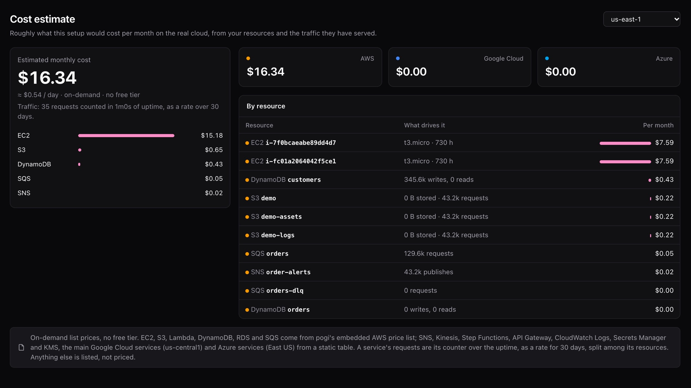

# Estimate cost

The **Cost** page in the console works out a monthly bill from the resources you created and the traffic your code sent. It also puts the total in the sidebar and on the Home page.

## See your estimate

1. Run your code or tests against pogi for a realistic stretch of time. The estimate comes from a rate, so a very short run gives a poor guide.
2. Open `http://localhost:7644/_pogi/cost`, or choose **Cost** in the console sidebar.
3. For AWS, pick a region at the top. Prices change with it. The default is your pogi region, or `us-east-1` if that region is not in the price list.
4. Read the "What drives it" column. It shows the numbers behind each row.

## How the estimate works

| Part | How it is counted |
|---|---|
| Resources | Always-on resources (a database, a VM, a Service Bus namespace) are billed for a full month of 730 hours. |
| Traffic | pogi counts each service's requests since it started, turns that into a rate and scales it to 30 days. The page shows how many requests it counted and over how much uptime. It then splits a service's requests among its resources. |
| Prices | On-demand list prices. No free tier and no discount. |

## What is priced

| Cloud | Priced services |
|---|---|
| AWS | EC2, S3, Lambda, DynamoDB, RDS and SQS, from an AWS price list built into pogi. SNS, Kinesis, Step Functions, API Gateway (REST and HTTP), CloudWatch Logs, Secrets Manager and KMS, from a fixed price table. |
| Google Cloud | Cloud Storage, Pub/Sub, Cloud Run, Cloud Functions, Firestore and Cloud SQL. Prices are for `us-central1`. |
| Azure | Blob Storage, Functions, Service Bus (Standard tier, including its base fee), Cosmos DB (serverless) and Virtual Machines. Prices are for East US, Linux, pay-as-you-go. |

Anything else shows as "not priced" and adds nothing to the total, so the real bill could be higher.

## Guesses pogi makes about traffic

- A quarter of storage requests are writes or lists. The rest are reads.
- An average log event or message is half a kilobyte.
- A Step Functions run passes through five states, unless it is an Express machine, which is billed per run.
- An average Cosmos DB request costs 5 request units.
- Firestore traffic is 80 percent reads and 20 percent writes.

The Cost page is part of the console. It has no CLI command or REST endpoint.

## See also

- [Console](../reference/console.md)
- [Coverage](../reference/coverage.md)
