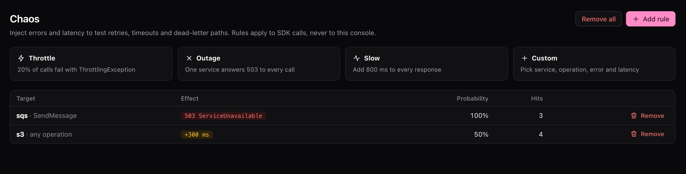

# Inject chaos

Real clouds fail. A queue throttles you, a service is down for a minute, a call takes three seconds. A **chaos rule** makes pogi do the same, so you can see how your code copes before production does.

A rule says which calls it matches, how often it applies, and what to do: return an error, add delay, or both. Rules apply to calls from SDKs and CLIs. They never apply to the console.

## Add a rule

1. Add a rule. This one makes every SQS `SendMessage` call fail:

   ```bash
   pogi chaos add --service sqs --op SendMessage --status 503 --code ServiceUnavailable
   ```

   ```text title="Output"
   added rule ea4255df
   ```

2. Make the call. The AWS CLI shows this after its retries:

   ```text title="Output"
   aws: [ERROR]: An error occurred (ServiceUnavailable) when calling the SendMessage operation (reached max retries: 2): injected by pogi chaos rule ea4255df
   ```

To add delay instead of an error, use `--latency`. This slows half of the S3 calls by 300 milliseconds:

```bash
pogi chaos add --service s3 --latency 300ms --rate 0.5
```

| Flag | Meaning |
|---|---|
| `--service` | Service to match, as a pattern. Default: any. `pogi services` lists the names. |
| `--op` | Operation to match, as a pattern, such as `Put*`. Default: any. |
| `--rate` | Chance that a matching call is affected, from 0 to 1. Default: 1 (every call). |
| `--status` | HTTP status to return, such as `500`. |
| `--code` | Error code to return, such as `ThrottlingException`. |
| `--message` | Error message to return. |
| `--latency` | Delay to add, such as `300ms`. |

Give `--status`, `--latency` or both. With neither, pogi stops with `chaos add: give --status and/or --latency`.

## List rules

```bash
pogi chaos ls
```

```text title="Output"
ID        SERVICE  OP           RATE  LATENCY  ERROR                   HITS
ea4255df  sqs      SendMessage  100%  0ms      503 ServiceUnavailable  3
167df292  s3       *            50%   300ms    0                       0
```

`HITS` counts how many times the rule has fired. `pogi chaos` alone does the same as `pogi chaos ls`.

## Remove rules

Remove one rule, or all of them:

```bash
pogi chaos rm ea4255df
pogi chaos clear
```

The first prints `removed rule ea4255df`. The second prints `removed all chaos rules`.

## Use it on any cloud

Each service returns errors in its own style, so your SDK sees an error it knows. The same kind of rule on Cloud Storage gives a Google-style JSON error:

```bash
pogi chaos add --service gcs --status 503 --code UNAVAILABLE --message "try again"
curl "http://localhost:7644/storage/v1/b?project=pogi"
```

```json title="Response"
{"error":{"code":503,"errors":[{"domain":"global","message":"try again","reason":"UNAVAILABLE"}],"message":"try again","status":"UNAVAILABLE"}}
```

On Key Vault it gives an Azure-style error.

## Use the console

Open **Chaos** in the sidebar. It has four starting points:

| Starting point | What it does |
|---|---|
| Throttle | 20 percent of calls fail with `ThrottlingException`. |
| Outage | One service returns 503 for every call. |
| Slow | 800 ms added to every call. |
| Custom | You set the rule. |

The Activity page marks calls that a rule changed. It has a **Chaos** filter chip.



## Keep rules in pogi.yaml

Rules in `pogi.yaml` are there at every start:

```yaml title="pogi.yaml"
chaos:
  - {name: flaky-sqs, service: sqs, op: SendMessage, rate: 0.1, status: 500}
  - {name: slow-dynamodb, service: dynamodb, latency: 300ms}
```

`rate` runs from 0 to 1, and 0 means always, the same as 1. The CLI flag `--rate` defaults to 1, and the REST field `probability` works like `rate`.

## Use it from a script

The REST API has the same rules: `GET`, `POST` and `DELETE` on `/_pogi/api/chaos`.

AWS also has a Fault Injection Service emulator, for tools that create experiments through the AWS API. Chaos rules are the quick way to do the same from the pogi CLI.

## See also

- [REST API](../reference/rest-api.md)
- [CLI](../reference/cli.md)
- [Configuration](../reference/configuration.md#pogiyaml)
