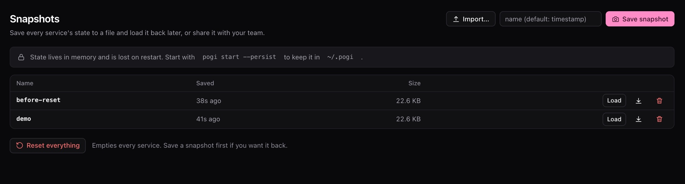

# Save and load snapshots

A **snapshot** is a named copy of the state of every service. Save one when your setup is right, such as a seeded database and a few queues. Load it after a test has changed things, or hand the file to a teammate.

## Save, list, load and delete

1. Save everything under the name `demo`:

   ```bash
   pogi snapshot save demo
   ```

   ```text title="Output"
   saved demo
   ```

   With no name, `save` uses the date and time as the name.

2. List the snapshots:

   ```bash
   pogi snapshot ls
   ```

   ```text title="Output"
   NAME  SIZE   SAVED
   demo  15606  2026-10-13 21:05:46
   ```

   `ls` is the default, so `pogi snapshot` alone lists snapshots too.

3. Load the snapshot when a test has changed things:

   ```bash
   pogi snapshot load demo
   ```

   ```text title="Output"
   loaded demo
   ```

   `load` replaces the current state of every service. Anything created after the save is gone.

4. Delete the snapshot when you no longer need it. It prints nothing:

   ```bash
   pogi snapshot rm demo
   ```

Snapshots are stored in the `snapshots` folder of pogi's data folder. The data folder is `~/.pogi` unless you set `--data-dir`.

## Share a snapshot

1. Export a snapshot to a file. Without a file name, it goes to standard output:

   ```bash
   pogi snapshot export demo demo.snap
   ```

2. On the other machine, import the file. The name defaults to the file name without its extension. Give a name to choose your own:

   ```bash
   pogi snapshot import demo.snap team-seed
   ```

   ```text title="Output"
   imported team-seed (load it with: pogi snapshot load team-seed)
   ```

3. Load it when you want it. Importing only stores the snapshot:

   ```bash
   pogi snapshot load team-seed
   ```

## Reset

`pogi reset` deletes state without saving it. Save a snapshot first if you may want the state back.

1. Save a snapshot, if you want one:

   ```bash
   pogi snapshot save before-reset
   ```

2. Reset. Name services to reset only those:

   ```bash
   pogi reset s3 sqs
   ```

   ```text title="Output"
   reset s3, sqs
   ```

## Use the console

The **Snapshots** page lists snapshots and has Save, Load, Download, Delete and Import buttons, and a **Reset everything** button. **Home** also has a **Save snapshot** button.



## Keep state across restarts

State lives in memory by default, so stopping pogi clears it. To keep it, pick a mode with `--storage`, or `storage:` in `pogi.yaml` (you can set it per service). `--persist` is short for `hybrid`.

| Mode | On disk |
|---|---|
| `memory` | Nothing. This is the default. |
| `hybrid` | Every service's state, written every few seconds and when pogi exits. |
| `persistent` | Written before each write request is answered. |
| `wal` | DynamoDB, SQS and S3 append each change to a journal. Other services work as in `persistent`. |

Start pogi with the mode you picked:

```bash
pogi start --storage persistent
```

`persistent` and `wal` survive a `kill -9` without losing a write that pogi already acknowledged. State files are in the `state` folder of the data folder, one file per service.

## Use it from a script

The same actions are in the REST API under `/_pogi/api/snapshots`.

## See also

- [REST API](../reference/rest-api.md)
- [Configuration](../reference/configuration.md#storage-modes)
- [CLI](../reference/cli.md)
