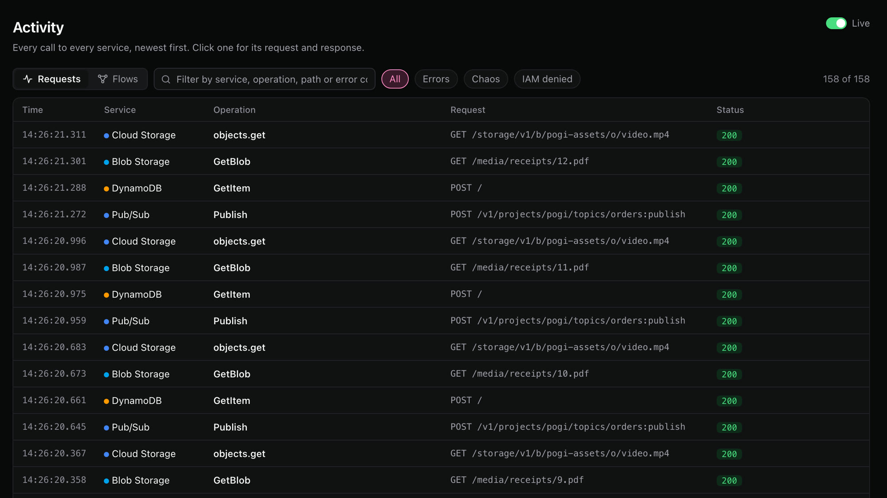
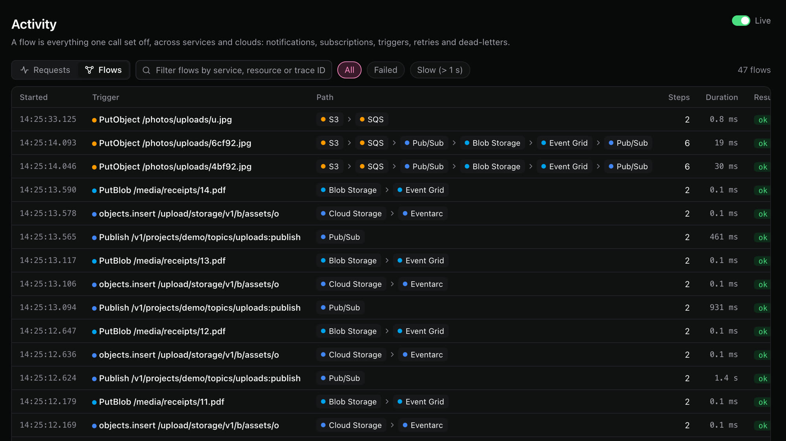
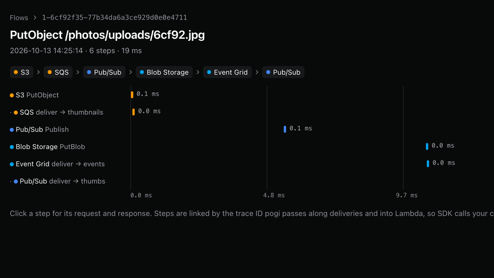
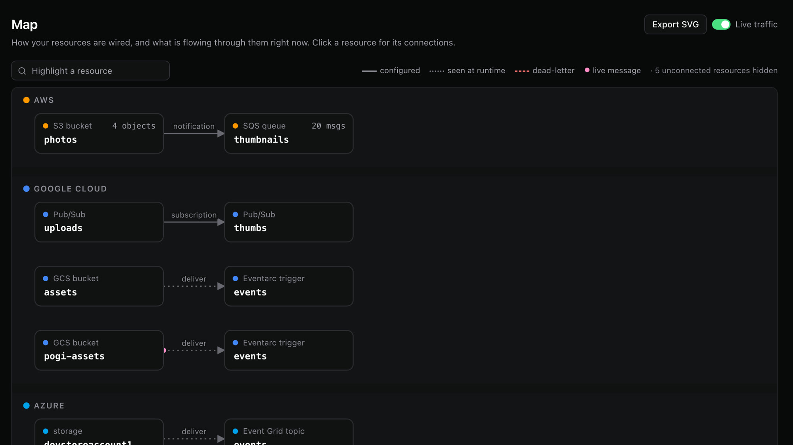

# Console

`http://localhost:7644/_pogi/`

The console is a web page that pogi serves itself. Open it in a browser on your own machine. It is built for a laptop screen.

| Page | Path | What it shows |
|---|---|---|
| [Home](#home) | `/_pogi/` | Services in use, resources and recent calls. |
| [Activity](#activity) | `/_pogi/requests` | Every call, newest first, in the Requests view. Its Flows view is the Flows page. |
| [Flows](#flows) | `/_pogi/flows` | Everything one call set off. |
| [Services](#services) | `/_pogi/services` | All emulated services. |
| [Map](#map) | `/_pogi/map` | How your resources are wired. |
| [Resources](#resources) | `/_pogi/resources/{service}` | Tables of a service's resources. |
| [Tools](#tools) | | SQL, logs, secrets, IAM policy, cost, inbox, chaos, snapshots and connect. |
| [IAM form posts](#iam-form-posts) | `/_pogi/iam/...` | The requests behind the IAM page buttons. |

Press `⌘K` (or `Ctrl+K`) on any page to search services, resources and actions. A cloud picker at the top narrows every page to AWS, Google Cloud or Azure. The sidebar lists the main pages (Home, Activity, Flows, Services and Map), the services that are in use, your pinned services and the tools. The sidebar footer, Home and the Services page show how many services pogi covers, counted as products (the same count as the README). They also show how many have real behavior and how many are Thin.

### Service icons

Each service has an icon: the cloud provider's own icon for it, or, when the provider has none for that service, its category icon (Google Cloud) or one of pogi's plain glyphs. Icons show in the sidebar (in the collapsed sidebar the icon replaces the name, and the name is the tooltip), in the header of each service page, in `⌘K` results and on [Map](#map) nodes. A small colored dot on the icon marks the cloud. The Services page and Home tiles show no icons. The icons are not under pogi's MIT license: see [Third-party icons](https://github.com/nrndev/pogi#third-party-icons).

### In use

A service is "in use" when it has had a call, or when it holds more resources than it started with. A service you fill only from the console shows up too. The built-in defaults (the default resource group, project and users) do not count.

### Deep, Core and Thin

Every service carries one of three badges. Hover a badge to read what it means, or see [Coverage](coverage.md).

- **Deep:** real behavior, plus wiring to other services.
- **Core:** the main API, with real behavior.
- **Thin:** stores your resources and reads them back (create, describe and delete), but nothing runs behind them. That is enough for infrastructure tools such as Terraform.

## Home

`/_pogi/`

Shows how many services are in use (out of the services pogi covers), how many resources they hold, a live feed of recent calls, and quick actions such as saving a [snapshot](../how-to/save-and-load-snapshots.md). On the first run it shows a welcome with your endpoint.

## Activity

`/_pogi/requests`

The **Requests** view shows every call to every service, newest first. Click a call to see its request and response. The same list is in the [REST API](rest-api.md#list-requests). The **Flows** view is the [Flows](#flows) page.

| Filter | Meaning |
|---|---|
| Text box | Matches service, operation, path or error code. |
| **Errors** | Calls with a status of 400 or above. |
| **Chaos** | Calls that a chaos rule changed. |
| **IAM denied** | Calls that IAM refused. |

Changes you make in the console (creating a queue, deleting a row) are listed too, with a small **console** label, so you can see what the console did for you. Reads the console makes to draw its own pages are not listed.



## Flows

`/_pogi/flows`

A flow is everything one call set off, across services and clouds: notifications, subscriptions, triggers, retries and dead-letters. Each row shows the first call, the path it took, how many steps there were and how long it all took.

| Filter | Meaning |
|---|---|
| **All** | Every flow. |
| **Failed** | Flows with a failed step. |
| **Slow** | Flows that took more than 1 second. |



Click a flow to see its steps on a timeline. Click a step for its request and response.



## Services

`/_pogi/services`

Lists all the emulated services, grouped by category, with the full name of each (long names wrap to two lines). Star a service to pin it to the sidebar.

## Map

`/_pogi/map`

Shows your resources as boxes, grouped by cloud, with a line for each connection. Click a resource for its connections. You can export the map as SVG. Resources with no connection are hidden, and the legend says how many.

| Mark | Meaning |
|---|---|
| Solid line | A link the service reports from its own settings, such as an S3 bucket notification, an SNS subscription or an event source mapping. |
| Dotted line | A delivery pogi saw at run time, in the last 15 minutes. |
| Red dashed line | A dead-letter route: a dead-letter queue that is set up, or a message pogi moved to one. |
| Pink dot | A delivery in the last 10 seconds. It is red when the delivery failed. |



## Resources

`/_pogi/resources/{service}`

Click a service under "In use" to browse its resources in tables. Create resources from a form. Every create form has a CLI mirror, which shows the matching command so you can repeat the action in a script.

### Feedback while you work

- **Busy buttons.** While a form is sending, its buttons are locked and the one you pressed says what is happening ("Creating…", "Saving…", "Deleting…"). They come back when the request ends, even if it failed. A double click cannot send twice.
- **Names in messages.** Messages say what happened to which resource: "Bucket photos created", "Queue jobs deleted". After a page reload, the message shows as a green bar at the top of the page.
- **Confirm dialog.** Deleting, resetting and removing ask first in pogi's own dialog. Cancel is selected, Esc cancels, and nothing is sent. Focus goes back to the button you used.
- **Live rows.** While a row is `creating`, `modifying`, `deleting` or in a similar state, the table refreshes itself every 2 seconds. It stops when every row has settled. It waits while you have a row ticked, a menu or drawer open, or a link focused. Rows never show a pop-up on their own: the bell does that.
- **Background work.** When pogi is downloading an image or starting a container for a resource, its status cell says so ("Downloading mariadb:11.4 · 140 of 410 MB", or "Starting…"). A failed row shows the reason in plain words.
- **Activity indicator.** A small dot in the top bar shows while pogi has background work running. Click it to see each task and its progress. It is hidden when nothing is running, and it only pulses if your system allows motion.

Some services have their own pages:

| Service | What you can do |
|---|---|
| S3, Cloud Storage, Blob Storage | Browse, upload and download objects. |
| SQS | Send, peek at and purge messages. |
| Lambda | Invoke a function with a test event. |
| SNS and EventBridge | Publish a message or put an event. |

## Tools

The sidebar lists these under "Tools".

| Tool | Path | What it does |
|---|---|---|
| SQL editor | `/_pogi/sql` | Runs SQL against RDS, Cloud SQL and Azure databases. It runs statements inside the database's container, so it needs Docker. |
| Logs | `/_pogi/logs` | Searches CloudWatch Logs (Logs Insights), Azure Monitor (KQL) and Cloud Logging. |
| Secrets | `/_pogi/secrets` | Shows Secrets Manager, SSM, Secret Manager and Key Vault values. A value stays hidden until you reveal it. Every reveal is logged. |
| IAM policy | `/_pogi/iam` | Records what each user and role calls, and writes the IAM policy (the rules for who may call what). See [Switch IAM modes](../how-to/switch-iam-modes.md). |
| Cost | `/_pogi/cost` | A rough monthly bill for what is running. See [Estimate cost](../how-to/estimate-cost.md). Its **Terraform** tab prices Terraform code: see [The Terraform page and tab](#the-terraform-page-and-tab). |
| Inbox | `/_pogi/inbox` | Email, SMS and push messages your apps send through SES, SNS, Azure Email and Firebase Auth. pogi keeps them here instead of delivering them. |
| Chaos | `/_pogi/chaos` | Adds and removes chaos rules (rules that make chosen calls fail or slow down). See [Inject chaos](../how-to/inject-chaos.md). |
| Snapshots | `/_pogi/snapshots` | Saves and loads state. See [Save and load snapshots](../how-to/save-and-load-snapshots.md). |
| Connect | `/_pogi/connect` | Copy-ready snippets for your shell, the AWS CLI, Terraform, the SDKs, Google Cloud and Azure. |

The console shows your calls only. Chaos rules never apply to the console itself.

## The Terraform page and tab

`/_pogi/terraform` and `/_pogi/cost/terraform`

**Terraform**, under Tools in the sidebar, loads a Terraform folder or a `plan.json` and draws the resources. The Cost page's **Terraform** tab shows the same stack as a table. pogi keeps the last stack that loaded in memory, never on disk. See [Estimate Terraform cost](../how-to/estimate-terraform-cost.md) and [See what a plan changes](../how-to/see-what-a-plan-changes.md).

| Part | Where | What it does |
|---|---|---|
| Start | Terraform page | **Choose folder** uses the browser's own folder picker, **Choose plan.json** takes a plan, and **Try a sample** uses a built-in stack. You can also drop a folder or a plan on the page. The browser sends only Terraform files and plans. `pogi tf diagram` does the same from the command line. |
| Diagram | Terraform page | The resources, their references, and for a plan, what it changes. Group by module or network. Pan, zoom, select and export. A panel beside it shows the selected resource. |
| Export | Terraform page | SVG, PNG, JSON and Markdown. |
| Totals | Cost tab | The monthly cost and one total per cloud. For a plan: the cost before, after and the change. |
| Table | Cost tab | Resources grouped by module, service or cloud, with service, region, monthly price, **What drives it** and a status (assumed, usage, needs a value, free, not priced). Click a row for its price lines and notes. |
| Variable files | both | Chips for each `.tfvars` file in the folder. They turn on and off. |
| Try another size | Cost tab | On a VM, node pool, database or cache. Picking a size is a what-if, and **Reset** undoes it. |
| Open diagram | Cost tab | A link to the Terraform page. With nothing loaded, the tab links there too. |

The files stay on your machine. The page sends them to your pogi, which reads them in memory and keeps nothing on disk.

### Terraform form posts

These are the requests behind the tab. They are not part of the [REST API](rest-api.md), and they may change between releases. The posts follow the [same-origin rule](rest-api.md#same-origin-rule).

| Method and path | What it does |
|---|---|
| `POST /_pogi/terraform` (also `POST /_pogi/cost/terraform`) | One handler for both pages. With files, sent as `multipart/form-data` (each file's name is its path in the folder), the files become the held stack once they load. A failed or too-large upload keeps the old stack. Without files, it uses the held stack, or returns `400` if none is held. Fields: `vars` (a variable file, repeatable), `sizes` (JSON of address to size), `expanded` (a module to draw in full, repeatable), `group` (`module`, `service` or `cloud`: the table), `layout` (`module` or `network`: the diagram), `view` (`table` or `diagram`: which HTML to return), `format` (`json`, `markdown` or `svg` for a download) and `state` (set it to make the other view fields replace the held ones; with files they always do). |
| `GET /_pogi/terraform` | The Terraform page, showing the held stack. |
| `GET /_pogi/cost/terraform/sizes` | The size list for one row, as HTML. Query: `column`, `region`, `current`, `address`, `attr`. |
| `GET /_pogi/terraform/sample` | The built-in sample, as JSON of path to file content. |

pogi checks every file name (relative, no `..`) and the [limits](terraform-cost.md#limits), and returns `400` or `413` with a message when one fails.

## IAM form posts

`/_pogi/iam/...`

These are the requests behind the buttons on the IAM page. They are HTML forms, not JSON: send the fields as `application/x-www-form-urlencoded`. They are not part of the [REST API](rest-api.md), and they may change between releases.

Every `POST` returns `303` with no body. A failed action redirects to an address with `err=` in it, so check the `Location` header. These calls follow the [same-origin rule](rest-api.md#same-origin-rule).

| Method and path | Fields | What it does |
|---|---|---|
| `POST /_pogi/iam/mode` | `mode`: `off`, `soft` or `strict` | Sets the IAM mode for all clouds. Any other value is refused: the response redirects to the IAM page with `err=unknown mode`, and the mode does not change. |
| `GET /_pogi/iam/policy` | `principal`: a user or role ARN (the ID AWS gives a resource). `fmt=tf` for Terraform. | Returns the policy recorded for the principal. If nothing is recorded for it, the response is `404` with `nothing recorded for <principal>`. Without `principal`, it is `404` with `missing principal`. |
| `POST /_pogi/iam/attach` | `principal` | Creates or updates the policy `pogi-<name>` and links it to the principal. |
| `POST /_pogi/iam/undo` | `principal`, `policy`, `arn`, `attached` (the version), `prev`, `linked` | Undoes an attach. The attach redirect carries these values. |
| `POST /_pogi/iam/restart` | `principal` | Clears what is recorded for the principal. |
| `GET /_pogi/iam/gcp/snippet` | `principal`: a member such as `serviceAccount:…`. `fmt=tf`. `role=custom`. | Returns the `gcloud` commands, or Terraform, that grant the recorded roles. |
| `POST /_pogi/iam/gcp/attach` | `principal`, `role=custom` | Adds the role bindings to the project. |
| `POST /_pogi/iam/gcp/undo` | `u`, `principal` | Undoes an attach. `u` is in the attach redirect. |
| `POST /_pogi/iam/gcp/restart` | `principal` | Clears what is recorded. |
| `GET /_pogi/iam/azure/policy` | `principal`. `fmt=cli`. | Returns the custom role as JSON, or as Azure CLI commands. |
| `POST /_pogi/iam/azure/attach` | `principal` | Creates the custom role and assigns it. |
| `POST /_pogi/iam/azure/undo` | `principal`, `role`, `roleid`, `assignment`, `scope`, `existed` | Undoes an attach. The attach redirect carries these values. |
| `POST /_pogi/iam/azure/restart` | `principal` | Clears what is recorded. |

Set the mode:

```bash
curl -si -X POST localhost:7644/_pogi/iam/mode -d mode=soft | grep -iE '^(HTTP|location)'
```

```text title="Response"
HTTP/1.1 303 See Other
Location: /_pogi/iam?ok=Enforcement%3A+soft&principal=
```

An unknown mode redirects with an error:

```text title="Response"
HTTP/1.1 303 See Other
Location: /_pogi/iam?err=unknown+mode+%22bogus%22
```

Get the recorded policy for a user:

```bash
curl "localhost:7644/_pogi/iam/policy?principal=arn:aws:iam::000000000000:user/dev"
```

```json title="Response"
{
  "Version": "2012-10-17",
  "Statement": [
    {
      "Effect": "Allow",
      "Action": "s3:ListAllMyBuckets",
      "Resource": "*"
    },
    {
      "Effect": "Allow",
      "Action": "sqs:ListQueues",
      "Resource": "*"
    }
  ]
}
```

Ask for a principal that has no recorded calls and the response is `404` with `nothing recorded for <principal>`.

Attach it. The redirect carries the values that `undo` needs:

```bash
curl -si -X POST localhost:7644/_pogi/iam/attach -d principal=arn:aws:iam::000000000000:user/dev | grep -i '^location'
```

```text title="Response"
Location: /_pogi/iam?arn=arn%3Aaws%3Aiam%3A%3A000000000000%3Apolicy%2Fpogi-dev&attached=v1&linked=1&ok=Attached+v1+of+pogi-dev&policy=pogi-dev&prev=&principal=arn%3Aaws%3Aiam%3A%3A000000000000%3Auser%2Fdev
```

## See also

- [Switch IAM modes](../how-to/switch-iam-modes.md)
- [Flows and the Map](../explanation/flows-and-the-map.md)
- [REST API](rest-api.md)
