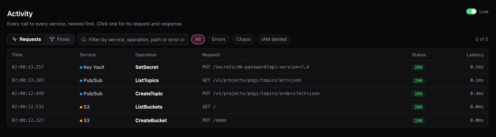

# First run

By the end, pogi runs and you've made one call on each cloud. About five minutes. You need pogi installed: see [Install pogi](../how-to/install.md).

## 1. Start pogi

```bash
pogi start
```

In a terminal this opens a live screen (the TUI) with requests, resources, chaos rules and snapshots. Without a terminal, or with `--headless`, pogi prints plain logs instead. It is ready when the last line says `Ready.`:

```text title="Output"
pogi 0.1.0  ·  181 services  ·  data ~/.pogi
  endpoint  http://127.0.0.1:7644
  console   http://127.0.0.1:7644/_pogi/
  env       eval "$(pogi env)"
Ready.
```

Scripts and CI can run `pogi wait`. It returns when pogi is ready:

```bash
pogi wait
```

```text title="Output"
ready: http://localhost:7644
```

If something goes wrong, see [Troubleshoot](../how-to/troubleshoot.md).

## 2. Point your tools at pogi

Open a second terminal. `pogi env` prints the settings that point AWS, Google Cloud and Azure tools at pogi. Load them into your shell:

```bash
eval "$(pogi env)"
```

For fish or PowerShell, add `--shell fish` or `--shell pwsh`. Run the printed lines in your session. The other values are `sh` (the default) and `dotenv`.

What `pogi env` sets:

| Cloud | Settings |
|---|---|
| AWS | `AWS_ENDPOINT_URL`, and test credentials (the key and secret are both `test`). |
| Google Cloud | `STORAGE_EMULATOR_HOST`, `PUBSUB_EMULATOR_HOST`, `FIRESTORE_EMULATOR_HOST`, `DATASTORE_EMULATOR_HOST`, `FIREBASE_AUTH_EMULATOR_HOST`, and `gcloud` settings. |
| Azure | The Storage connection string, and the Cosmos DB and Key Vault settings. |

Every current SDK and CLI reads these.

## 3. Make a call on each cloud

Do one, two or all three.

### AWS

```bash
aws s3 mb s3://demo
aws s3 ls
```

```text title="Output"
make_bucket: demo
2026-10-14 00:59:16 demo
```

`pogi aws s3 ls` runs the AWS CLI with the right settings, so it works before you load `pogi env`. It needs the AWS CLI installed.

### Google Cloud

```bash
gcloud pubsub topics create orders
gcloud pubsub topics list
```

```text title="Output"
Created topic [projects/pogi/topics/orders].
---
name: projects/pogi/topics/orders
state: ACTIVE
```

The default Google Cloud project is `pogi`.

### Azure

This stores a secret in Key Vault. pogi serves Key Vault over HTTPS on the main port. `--cacert` tells curl to trust pogi's local certificate authority (CA).

```bash
curl --cacert ~/.pogi/certs/ca.pem -X PUT \
  "https://localhost:7644/secrets/db-password?api-version=7.4" \
  -H "authorization: Bearer x" -H "content-type: application/json" \
  -d '{"value":"hunter2"}'
```

```json title="Response"
{"attributes":{"enabled":true,"created":1791919758,"updated":1791919758,"recoveryLevel":"Recoverable+Purgeable","recoverableDays":90},"id":"https://localhost:7644/secrets/db-password/db2daaa5f08c7c402622cb3b75dcd7a8","value":"hunter2"}
```

Run `pogi cert` to see where the CA file is and how to trust it for your whole system.

Azure Blob, Queue and Table Storage use ports 10000 to 10002, the same as Azurite. The connection string from `pogi env` already points there.

## 4. See the calls

```bash
pogi logs -n 5
```

```text title="Output"
00:59:16.741  aws   s3         CreateBucket                     200     0.1ms
00:59:17.305  aws   s3         ListBuckets                      200     0.2ms
00:59:18.177  gcp   pubsub     CreateTopic                      200     0.8ms
00:59:18.795  gcp   pubsub     ListTopics                       200     0.2ms
00:59:18.943  azure keyvault   SetSecret                        200     0.1ms
```

List the resources you made:

```bash
pogi ls s3
```

```text title="Output"
s3 · Buckets (1)
  NAME  REGION     ACCOUNT       OBJECTS  SIZE  VERSIONING  CREATED
  demo  us-east-1  000000000000  0        0 B               2026-10-13 19:29:16
```

`pogi ls` shows times in UTC. The AWS CLI and `pogi logs` use your local time.

## 5. Open the console

```bash tab="macOS"
open http://localhost:7644/_pogi/
```

```bash tab="Linux"
xdg-open http://localhost:7644/_pogi/
```

```powershell tab="Windows (PowerShell)"
start http://localhost:7644/_pogi/
```

Your calls are under **Activity**.



## Next steps

- Keep state between runs: [Save and load snapshots](../how-to/save-and-load-snapshots.md).
- Use Terraform, the CDK or an SDK: [Connect your tools](../how-to/connect-your-tools.md).
- Find which permissions your code needs: [Least privilege](least-privilege.md).
- Check your setup with `pogi doctor`, or fix a problem: [Troubleshoot](../how-to/troubleshoot.md).
- Start over with `pogi reset`.
- Look up the pages and settings: [Console](../reference/console.md) and [Configuration](../reference/configuration.md).
