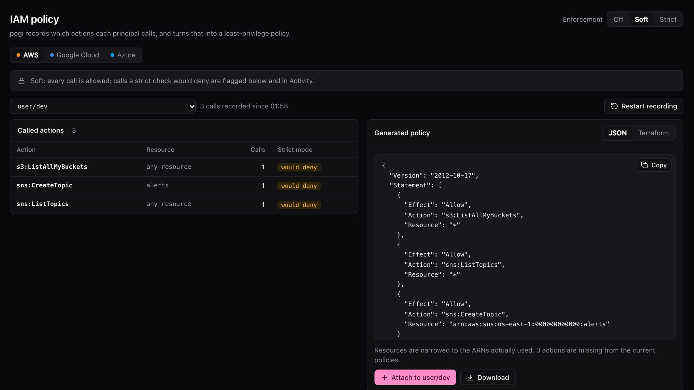
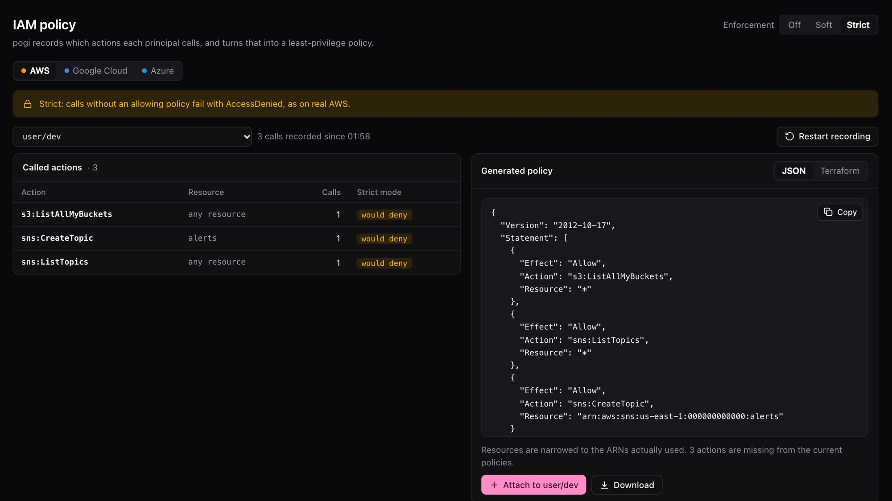
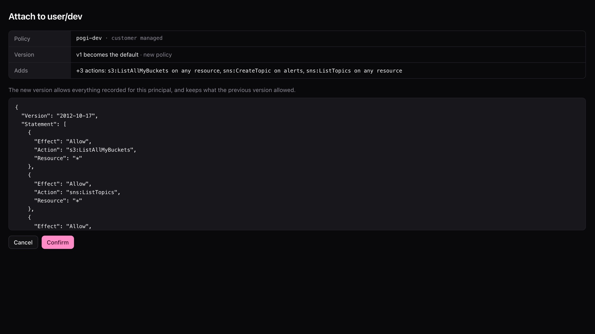
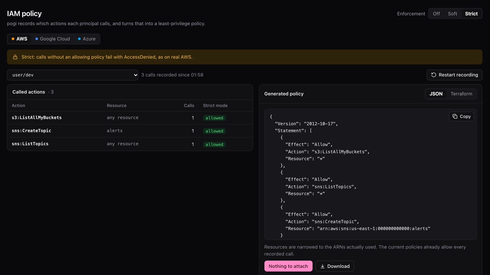

# Least privilege

By the end, you have the smallest set of permissions your code needs, and you've proved it works, all on your machine.

IAM (the rules for who may call what) controls access in a cloud. Least privilege means giving code the permissions it needs and no more. The hard part is knowing which ones those are. You do it in four moves:

1. Record the calls a user makes.
2. Read the policy pogi writes from them.
3. Switch to strict mode, where every call that no policy allows fails.
4. Attach the policy. The recorded calls pass and everything else still fails.

You need pogi running, the AWS CLI installed, and `eval "$(pogi env)"` loaded in your shell. See [First run](first-run.md).

## 1. Create a user and a key

The default `test` credentials are always allowed. Create a user with no permissions, and a key for it:

```bash
aws s3 mb s3://demo
aws iam create-user --user-name dev
aws iam create-access-key --user-name dev
```

The last command prints an `AccessKeyId` and a `SecretAccessKey`. Keep them for step 3.

## 2. Switch to soft mode

Soft mode allows every call and records what each user and role calls.

```bash
curl -X POST -d mode=soft http://localhost:7644/_pogi/iam/mode
pogi status | head -1
```

The first command prints nothing. The second shows the mode at the end of its line:

```text title="Output"
pogi 0.2.0 at http://localhost:7644 · up 57s · region us-east-1 · persistence false · iam soft
```

## 3. Run your code as that user

In the same terminal, use the new key in place of the `test` credentials:

```bash
export AWS_ACCESS_KEY_ID=<AccessKeyId from step 1>
export AWS_SECRET_ACCESS_KEY=<SecretAccessKey from step 1>
aws s3 ls
aws sns create-topic --name alerts
aws sns list-topics
```

```text title="Output"
2026-10-23 12:09:35 demo
{
    "TopicArn": "arn:aws:sns:us-east-1:000000000000:alerts"
}
{
    "Topics": [
        {
            "TopicArn": "arn:aws:sns:us-east-1:000000000000:alerts"
        }
    ]
}
```

pogi allowed every call and wrote down each action and the resource it touched. It never records calls signed with the default `test` credentials. It records calls from an IAM user's access key or an assumed role.

## 4. Read the policy

```bash
curl "http://localhost:7644/_pogi/iam/policy?principal=arn:aws:iam::000000000000:user/dev"
```

```json title="Response"
{
  "Version": "2012-10-17",
  "Statement": [
    {
      "Effect": "Allow",
      "Action": "s3:ListAllMyBuckets",
      "Resource": "*"
    },
    {
      "Effect": "Allow",
      "Action": "sns:ListTopics",
      "Resource": "*"
    },
    {
      "Effect": "Allow",
      "Action": "sns:CreateTopic",
      "Resource": "arn:aws:sns:us-east-1:000000000000:alerts"
    }
  ]
}
```

There is one statement for each action. Resources are narrowed to the ARNs your code used (an ARN is the ID AWS gives a resource). Add `&fmt=tf` to the address to get Terraform instead.

The console shows the same. Open **IAM policy**. For each principal (the user or role that makes a call) it lists the actions called, whether strict mode would deny them, and the policy in JSON or Terraform.



## 5. Switch to strict mode

Strict mode denies every call that no policy allows. The `dev` user has no policy yet, so nothing it calls would pass.

```bash
curl -X POST -d mode=strict http://localhost:7644/_pogi/iam/mode
```

It prints nothing. The IAM page now flags every recorded action:



Don't run the user's calls yet. Strict mode records denied calls too, so a policy built after that would allow them.

## 6. Attach the policy

Attaching saves the policy in pogi and links it to the user. In the console, choose **Attach** on the IAM page. pogi shows what the new version adds, and you confirm.



From the command line, post the form the button sends:

```bash
curl -X POST --data-urlencode "principal=arn:aws:iam::000000000000:user/dev" \
  http://localhost:7644/_pogi/iam/attach
```

It prints nothing either. To check, open a new terminal and run `eval "$(pogi env)"`. That loads the default credentials, which pogi never checks. Then run:

```bash
aws iam list-attached-user-policies --user-name dev
```

```json title="Output"
{
    "AttachedPolicies": [
        {
            "PolicyName": "pogi-dev",
            "PolicyArn": "arn:aws:iam::000000000000:policy/pogi-dev"
        }
    ]
}
```

The policy is named `pogi-dev`. pogi keeps its older versions, and you can undo an attach in the console.

Back on the IAM page, all three actions now show "allowed".



## 7. Run your code again

In the terminal where you set the `dev` key, run the calls again:

```bash
aws s3 ls
aws sns list-topics --query 'Topics[0].TopicArn' --output text
aws sqs list-queues
aws sns publish --topic-arn arn:aws:sns:us-east-1:000000000000:alerts --message hi
```

```text title="Output"
2026-10-23 12:09:35 demo
arn:aws:sns:us-east-1:000000000000:alerts

aws: [ERROR]: An error occurred (AccessDeniedException) when calling the ListQueues operation: User: arn:aws:iam::000000000000:user/dev is not authorized to perform: sqs:ListQueues on resource: * because no identity-based policy allows the sqs:ListQueues action

aws: [ERROR]: An error occurred (AccessDenied) when calling the Publish operation: User: arn:aws:iam::000000000000:user/dev is not authorized to perform: sns:Publish on resource: arn:aws:sns:us-east-1:000000000000:alerts because no identity-based policy allows the sns:Publish action
```

The two calls you recorded pass. The two you didn't record fail with `AccessDenied`, the same error AWS gives. In the console, Activity has an **IAM denied** filter, and the IAM page lists the two denied calls, flagged "would deny".

Your code can now make the calls it made, and no others. If it needs another action, run it in soft mode, then attach again.

## The same on Google Cloud and Azure

The IAM page has tabs for AWS, Google Cloud and Azure. The steps are the same. Only the names change.

### Google Cloud

pogi records calls made with an access token of a service account you created in IAM.

1. Create a service account. `gcloud` prints its email address. Use it wherever you see `<service-account-email>`.

   ```bash
   gcloud iam service-accounts create worker1
   ```

   ```text
   Created service account [worker1].
   ```

2. Get a token for it:

   ```bash
   curl -X POST "http://localhost:7644/v1/projects/pogi/serviceAccounts/<service-account-email>:generateAccessToken" \
     -H "content-type: application/json" \
     -d '{"scope":["https://www.googleapis.com/auth/cloud-platform"]}'
   ```

   ```json
   {"accessToken":"ya29.pogi-eyJlIjoid29ya2VyMUBw…","expireTime":"2026-10-13T16:39:04.390322Z"}
   ```

3. Make a call with the token:

   ```bash
   curl -H "Authorization: Bearer <accessToken>" "http://localhost:7644/storage/v1/b?project=pogi"
   ```

   ```json
   {"items":[],"kind":"storage#buckets"}
   ```

4. Read the roles the service account needs, as a `gcloud` command:

   ```bash
   curl "http://localhost:7644/_pogi/iam/gcp/snippet?principal=serviceAccount:<service-account-email>"
   ```

   ```text
   gcloud projects add-iam-policy-binding pogi --member=serviceAccount:<service-account-email> --role=roles/storage.admin
   ```

5. Attach the roles. Choose **Attach** on the Google Cloud tab, or post to `/_pogi/iam/gcp/attach` with `principal=serviceAccount:<service-account-email>`. Then `gcloud projects get-iam-policy pogi` lists the binding.

### Azure

pogi records calls made with the token of a service principal or managed identity that you created. It turns them into a least-privilege custom role. The Azure tab shows the role as JSON or as Azure CLI commands, and has the same **Attach** button.

pogi never records or denies calls made with its default credentials, on any cloud.

## See also

- [Switch IAM modes](../how-to/switch-iam-modes.md)
- [IAM: record, then enforce](../explanation/iam.md)
- [REST API](../reference/rest-api.md)
- [Console](../reference/console.md)
